<p align="center">
  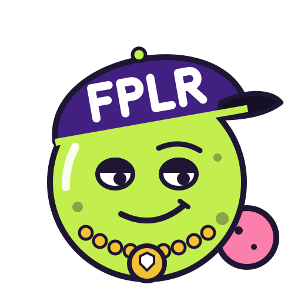
</p>

<h1 align="center">Fiji pa los reales</h1>

<p align="center">
  <strong>Macros de Fiji para análisis de imagen biológica, sin escribir código.</strong><br>
  Web · Android · Windows — en español
</p>

<p align="center">
  <a href="https://fiji-pa-los-reales.vercel.app"><strong>Abrir la aplicación web</strong></a> ·
  <a href="https://github.com/Alejandro-Plata/fiji-pa-los-reales/releases/latest">Descargar para Android y Windows</a>
</p>

<p align="center">
  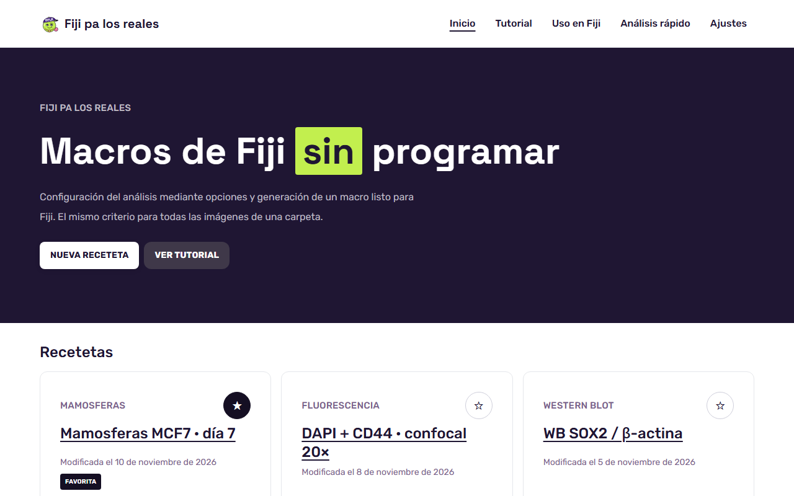
</p>

---

## Índice

- [Qué es](#qué-es)
- [El problema](#el-problema)
- [Cómo lo resuelve](#cómo-lo-resuelve)
- [Tipos de análisis](#tipos-de-análisis)
- [Recorrido por la aplicación](#recorrido-por-la-aplicación)
- [Plataformas e instalación](#plataformas-e-instalación)
- [Buenas prácticas de uso](#buenas-prácticas-de-uso)
- [Desarrollo](#desarrollo)

---

## Qué es

**Fiji pa los reales** es una aplicación que genera **macros de Fiji** a partir de opciones
elegidas en pantalla. Está pensada para laboratorios de biología celular que cuantifican imágenes
de microscopio y de western blot y necesitan hacerlo de forma **rápida, homogénea y documentada**,
sin conocimientos de programación.

[Fiji](https://imagej.net/software/fiji/) (una distribución de ImageJ) es el programa de análisis
de imagen de referencia en biología: gratuito, de código abierto y citado en decenas de miles de
publicaciones. Puede contar, medir y clasificar objetos de forma automática, pero para procesar
una carpeta completa de imágenes con un criterio fijo es necesario un **macro**: un pequeño
programa que encadena los pasos del análisis.

## El problema

Un experimento típico genera decenas o cientos de imágenes por condición. Cuantificarlas plantea
tres dificultades:

| Problema | Consecuencia |
| --- | --- |
| **Contar y medir a mano** es lento y subjetivo. | Horas de trabajo y diferencias entre personas, días o condiciones. |
| **Escribir macros** exige programar en el lenguaje de macros de ImageJ, con muchas particularidades. | La automatización queda fuera del alcance de buena parte de los investigadores. |
| **Documentar el análisis** (umbral, tamaños, filtros…) suele hacerse a posteriori y de memoria. | Métodos difíciles de reproducir y de justificar ante revisores. |

## Cómo lo resuelve

```
  Opciones en pantalla  ──►  Receteta  ──►  Macro .ijm  ──►  Fiji  ──►  Resultados
  (asistente guiado)        (guardada)     (generado)      (carpeta     (CSV, imágenes
                                                            completa)    de control, ROI)
```

1. **Receteta.** Cada análisis se define como una *receteta*: un conjunto guardado de ajustes
   (tipo de imagen, escala, método de detección, filtros de tamaño y forma, archivos de salida).
   Se configura una vez con un asistente guiado y se reutiliza durante todo el experimento.
2. **Macro.** La aplicación traduce la receteta a un macro de Fiji listo para ejecutar. El macro
   incluye en su cabecera **todos los parámetros utilizados**, de modo que el archivo `.ijm`
   documenta por sí mismo el análisis.
3. **Fiji.** El macro solicita la carpeta de imágenes y la de resultados, y procesa todas las
   imágenes con el mismo criterio.
4. **Resultados.** Tablas listas para Excel, imágenes de control con cada detección marcada y
   las selecciones (ROI) para revisar o corregir.
5. **Métodos.** La aplicación redacta además el párrafo de *Materiales y Métodos*, en español o
   inglés, con las referencias bibliográficas correspondientes.

Las imágenes no se suben a ningún servidor: el análisis definitivo se ejecuta en Fiji y el análisis
rápido se realiza en el propio dispositivo.

## Tipos de análisis

### Mamosferas

El **ensayo de formación de mamosferas** se utiliza para estudiar células con propiedades de
célula madre, especialmente en cáncer de mama. Las células se siembran en condiciones que impiden
su adhesión; la mayoría muere, pero las que tienen capacidad de autorrenovación proliferan y forman
agregados esféricos flotantes, las *mamosferas*.

La receteta de mamosferas:

- detecta las esferas en imágenes de **campo claro**, por bordes o por contraste;
- descarta los objetos por **tamaño** (por defecto, ≥ 50 µm de diámetro, el criterio más habitual
  en la bibliografía) y por **circularidad**, y excluye los cortados por el borde de la imagen;
- mide el diámetro equivalente y el área de cada esfera;
- calcula la **eficiencia de formación de esferas (SFE)**: esferas / células sembradas × 100.

### Fluorescencia

Para imágenes de **inmunofluorescencia** con una tinción nuclear (DAPI o Hoechst) y hasta tres
marcadores en canales adicionales:

- segmenta los núcleos por umbral automático o con **StarDist** (segmentación por aprendizaje
  profundo, más precisa cuando los núcleos están en contacto);
- mide la intensidad media o integrada de cada marcador en cada célula;
- clasifica cada célula como positiva o negativa respecto a un **umbral de positividad** y calcula
  el porcentaje de células positivas por imagen.

### Western blot

Para la **densitometría de bandas**:

- el macro abre la imagen y solicita marcar las bandas con un rectángulo de tamaño fijo;
- invierte la imagen si las bandas son oscuras sobre fondo claro y resta el fondo de la membrana
  (*rolling ball*);
- mide la señal integrada (`RawIntDen`) de todas las bandas con el mismo rectángulo;
- **avisa si hay píxeles saturados**, en cuyo caso la cuantificación no es fiable.

---

## Recorrido por la aplicación

### Inicio

Lista de recetetas guardadas, con acceso directo al macro de cada una, y las **plantillas**:
recetetas de ejemplo ya configuradas que sirven de punto de partida. Cada receteta puede abrirse,
duplicarse, renombrarse, compartirse, marcarse como favorita o borrarse.

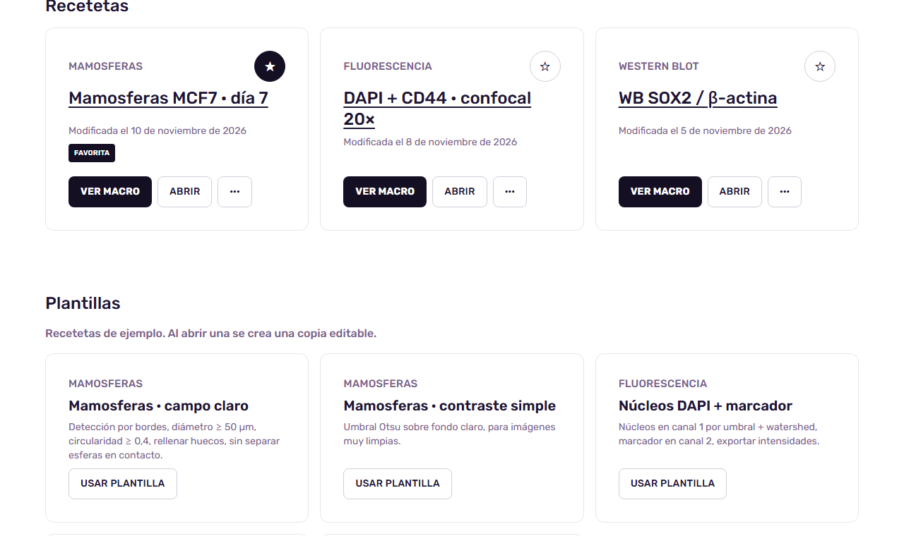

### Tutorial

Ocho diapositivas con ilustraciones animadas que resumen el funcionamiento de la aplicación y sus
posibilidades. Es el punto de entrada recomendado para nuevos usuarios.

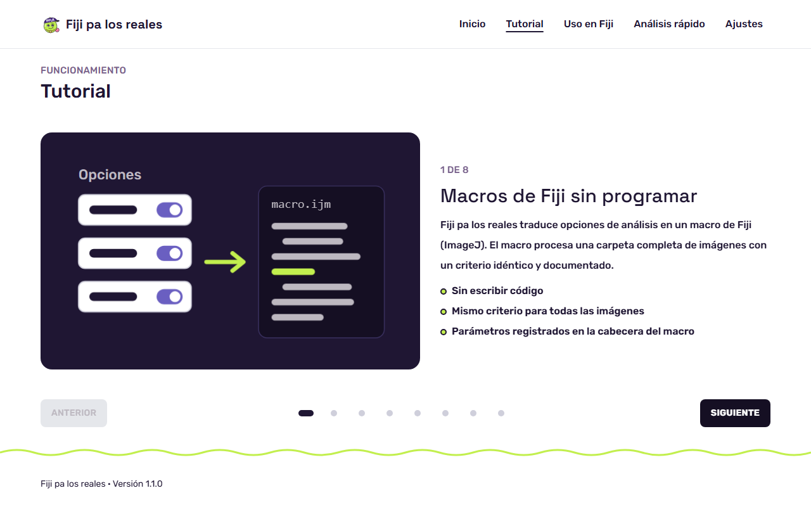

### Nueva receteta: el asistente

Primero se elige el tipo de análisis; después, el asistente agrupa las opciones en pasos
(**Imágenes**, **Detección**, **Filtros**, **Resultados** y **Nombre**).

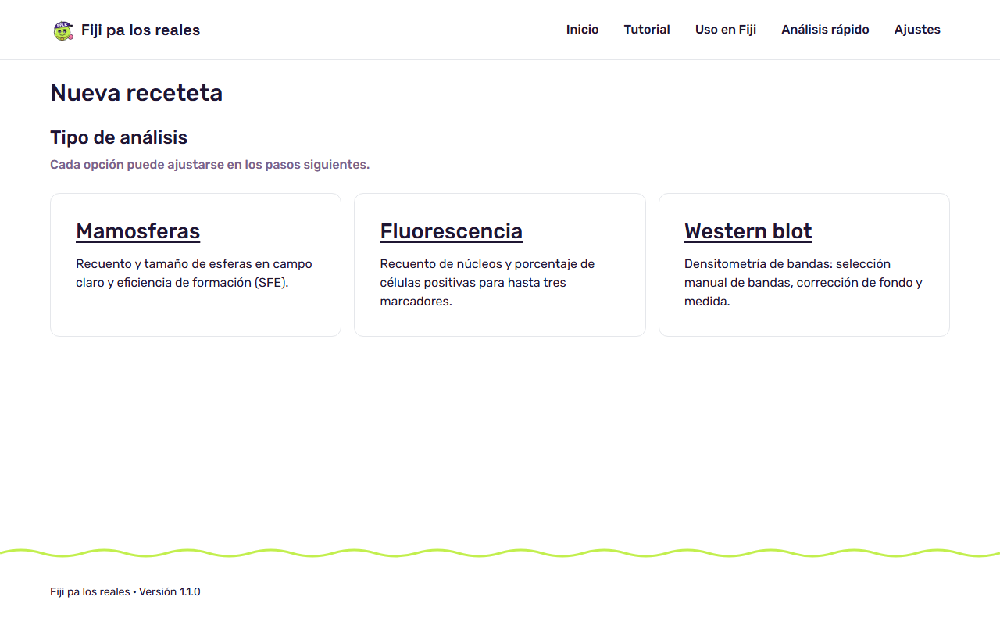

Cada campo incluye un botón **Información** que explica su efecto, y se indica el valor
recomendado. Los errores se señalan en el momento (por ejemplo, un diámetro mínimo mayor que el
máximo). En pantallas anchas, el resumen y el **macro** se muestran a la derecha y reflejan cada cambio. Los
cambios sin guardar se conservan como borrador.

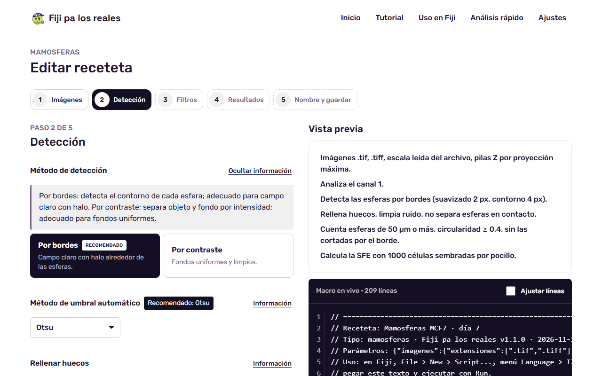

Los ajustes clave de cada paso:

| Paso | Qué se decide |
| --- | --- |
| Imágenes | Formatos (`.tif`, `.czi`, `.lif`, `.nd2`… vía Bio-Formats), **escala** en µm/píxel (leída del archivo o manual), combinación de pilas Z. |
| Detección | Canal analizado, método (bordes, contraste, umbral, StarDist), suavizado, corrección de fondo, separación de objetos en contacto. |
| Filtros | Tamaño mínimo y máximo, circularidad, exclusión de objetos del borde. |
| Resultados | Archivos que se guardan; células sembradas (SFE); marcadores y umbrales (fluorescencia). |

### El macro

Resumen legible de la receteta y el macro completo, con cuatro formas de llevarlo a Fiji:
**copiar**, **descargar** el archivo `.ijm`, **enviar al ordenador** (enlace o archivo) y la guía
de **ejecución en Fiji**.

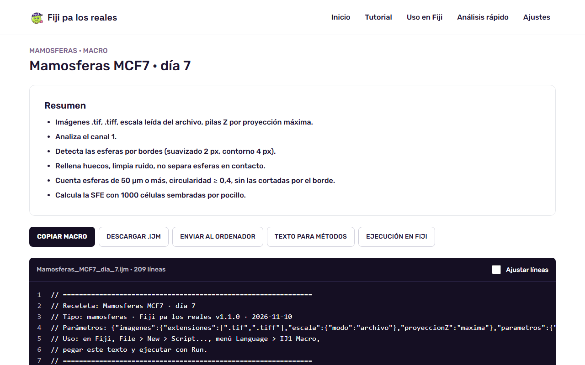

### Texto para Métodos

Párrafo de *Materiales y Métodos* que describe exactamente lo que hace el macro, en español o en
inglés, con las referencias (Fiji, StarDist, Bio-Formats…). Los datos que la aplicación no conoce,
como la versión de Fiji instalada, se indican entre corchetes.

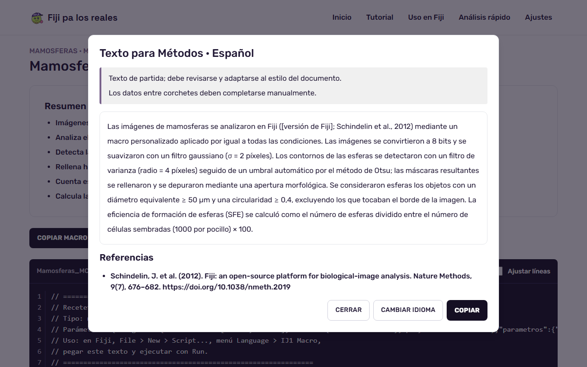

### Uso en Fiji

Guía paso a paso para quien no ha utilizado Fiji: instalación, apertura del macro, ejecución,
interpretación de resultados, reutilización, instalación de StarDist y validación de la receteta.
Incluye una tabla de **errores frecuentes** con su causa y solución.

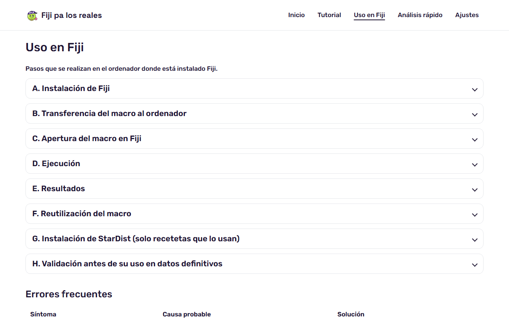

### Resultados en Fiji

Al ejecutar el macro sobre una carpeta, Fiji genera:

| Archivo | Contenido |
| --- | --- |
| `resumen.csv` | Una fila por imagen: recuento, tamaños medios, SFE o porcentaje de positivas. |
| `objetos.csv` | Una fila por esfera o núcleo, con todas sus medidas. |
| `control/` | Cada imagen con las detecciones marcadas y numeradas. |
| `rois/` | Las selecciones, para revisarlas o corregirlas en Fiji. |
| `log.txt` | Registro de la ejecución, con las imágenes omitidas y el motivo. |

Las **imágenes de control** son la herramienta principal para comprobar que la receteta detecta lo
que debe. Ejemplos reales generados por Fiji con macros de la aplicación (imágenes de prueba
sintéticas):

<p>
  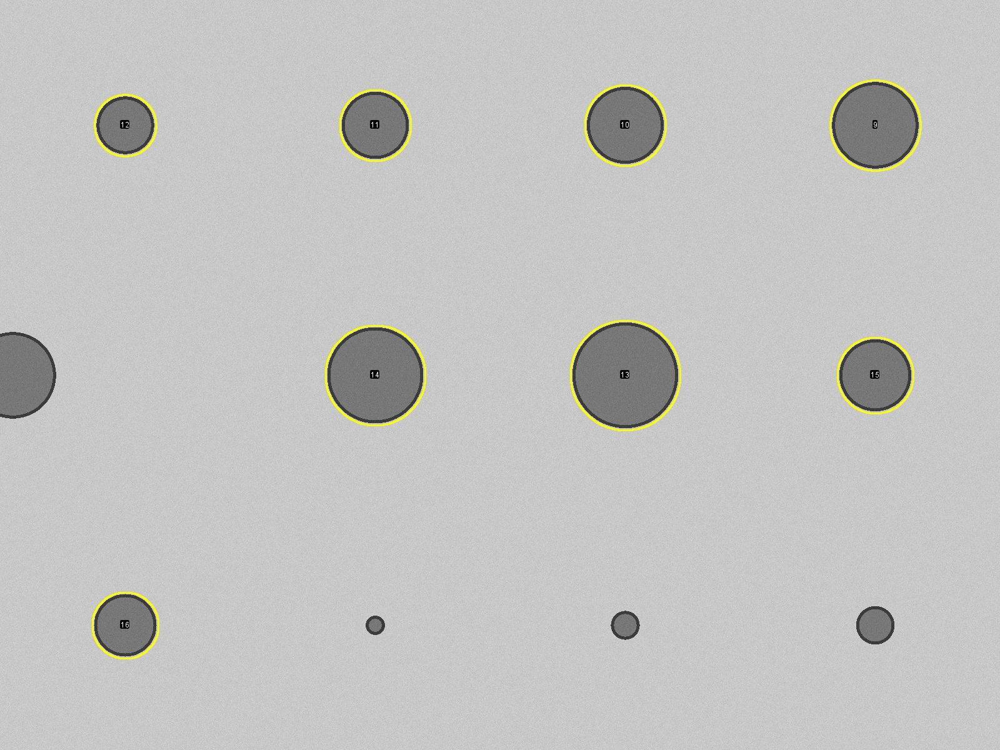
  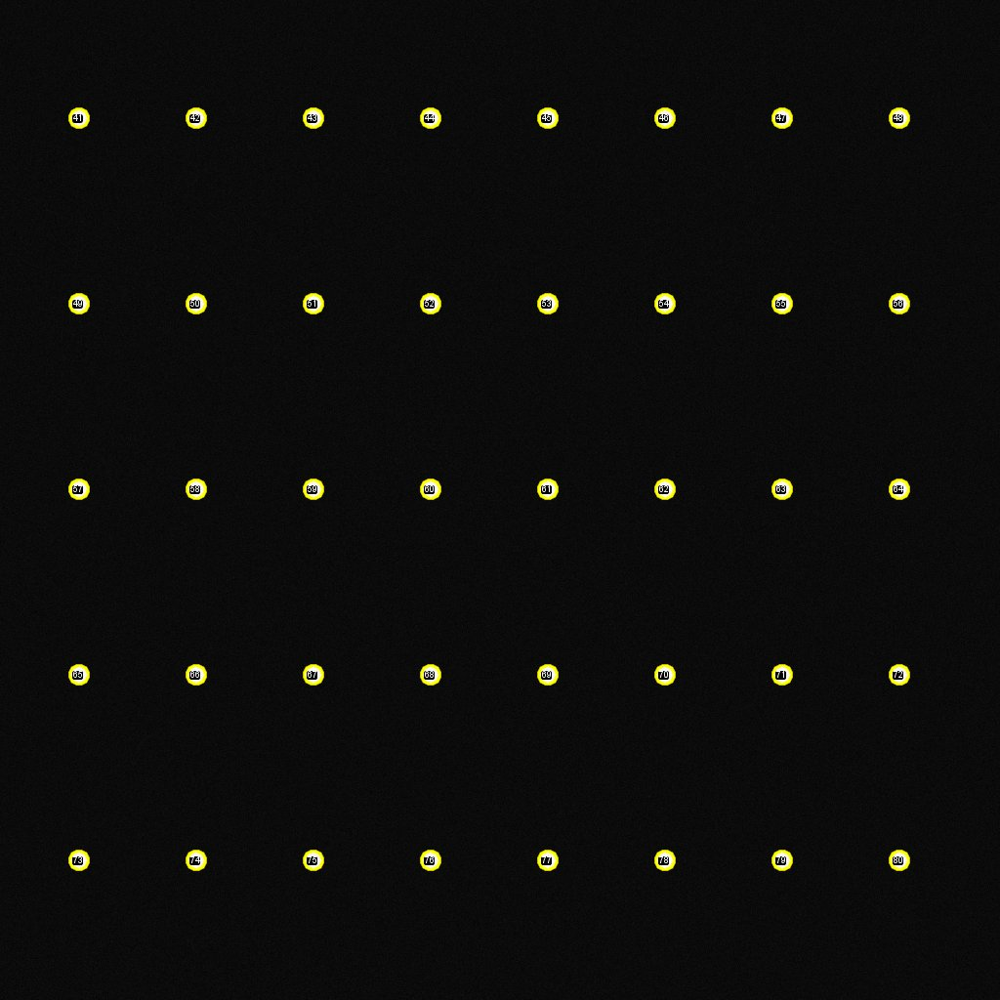
</p>

A la izquierda, las esferas contadas aparecen rodeadas en amarillo y numeradas. Los objetos
menores de 50 µm y la esfera cortada por el borde se excluyen, tal como indica la receteta.

### Análisis rápido

Recuento **orientativo** de esferas a partir de una foto tomada con el móvil a través del ocular o
de una imagen de la galería. Sirve para hacerse una idea al terminar
el ensayo y, sobre todo, para **ajustar los filtros viendo el efecto en la imagen**: los contornos
en lima se cuentan y los rosas se descartan. Los ajustes pueden guardarse después en una receteta.
La escala se lee del archivo, se introduce a mano o se **calibra marcando la barra de escala** de
la imagen.

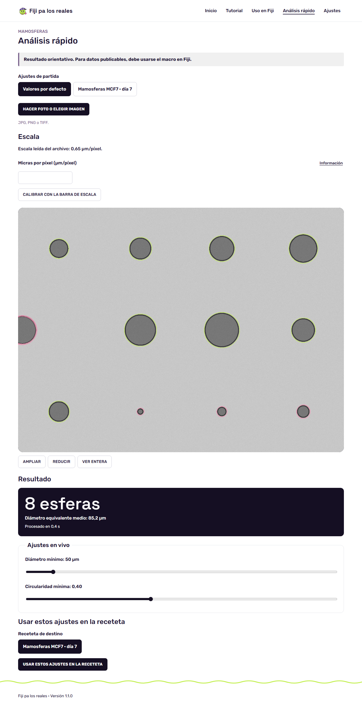

En las imágenes de prueba, el recuento coincide con el de Fiji. Aun así, los datos definitivos
deben obtenerse siempre con el macro en Fiji.

### Calcular umbral

En fluorescencia, el umbral de positividad debe basarse en un **control negativo** (sin anticuerpo
primario o con control de isotipo). Tras analizar el control con la misma receteta, se carga aquí
su `objetos.csv`. La aplicación propone como umbral un **percentil** configurable de la intensidad
del control (por defecto, el 99: solo el 1 % de las células del control resultaría positiva),
muestra sus estadísticas y lo guarda directamente en la receteta.

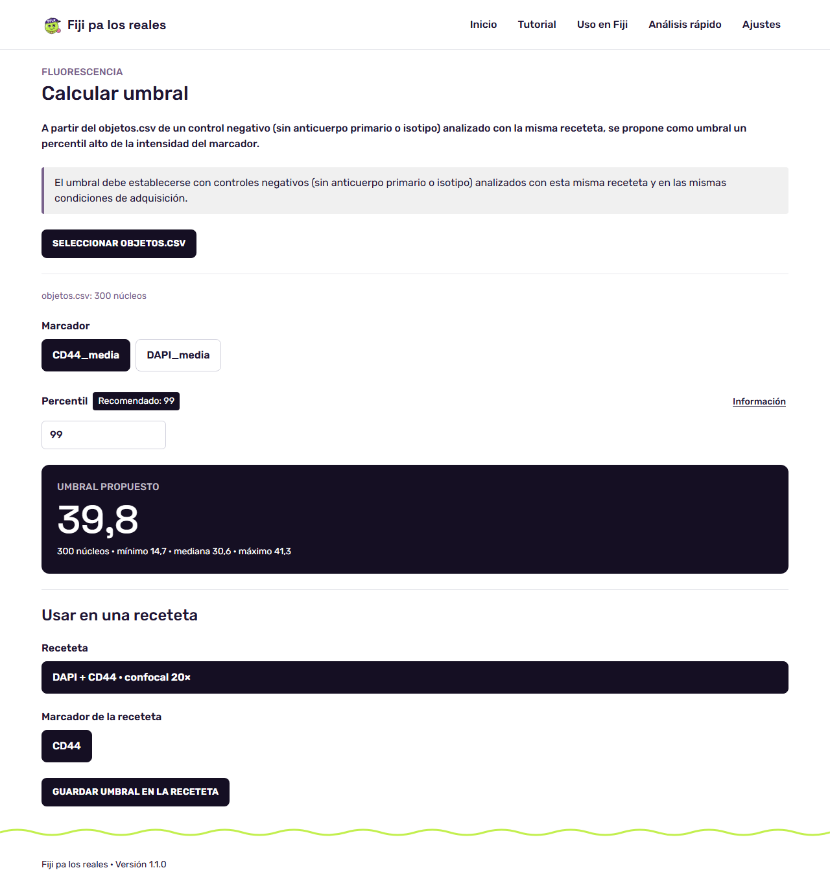

### Ajustes

- **Copia de seguridad**: exportación e importación de todas las recetetas en un archivo `.json`,
  que sirve también para trasladarlas entre dispositivos.
- **Idioma** inicial del texto de Métodos.
- **Actualizaciones**: en Android y Windows, aviso de versiones nuevas e instalación desde la propia
  aplicación. En la web, enlaces de descarga de las aplicaciones.
- **Borrar todos los datos**, con doble confirmación.

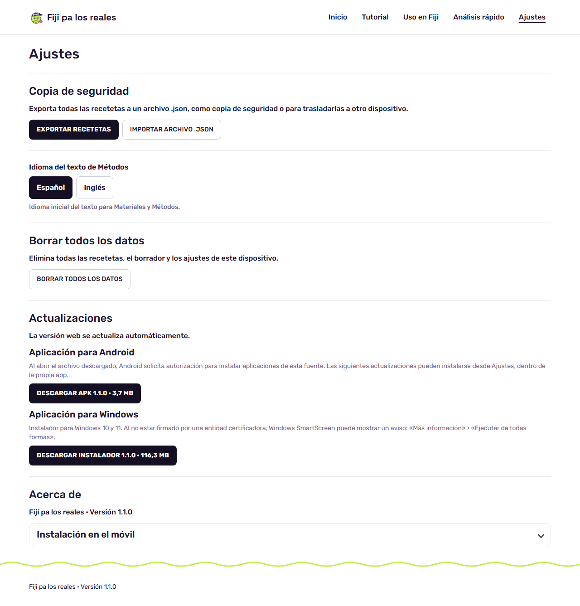

### Compartir recetetas

Cada receteta puede compartirse mediante un **enlace**. Al abrirlo en otro dispositivo, la receteta
se importa en la aplicación. Así un grupo de trabajo puede analizar con un criterio idéntico.

### En el móvil

La interfaz se adapta desde 320 px de ancho, con objetivos táctiles de al menos 44 px y la barra de
acciones del asistente fija en la parte inferior.

<p>
  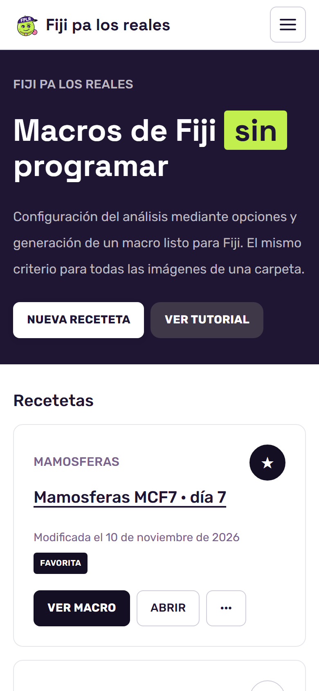
  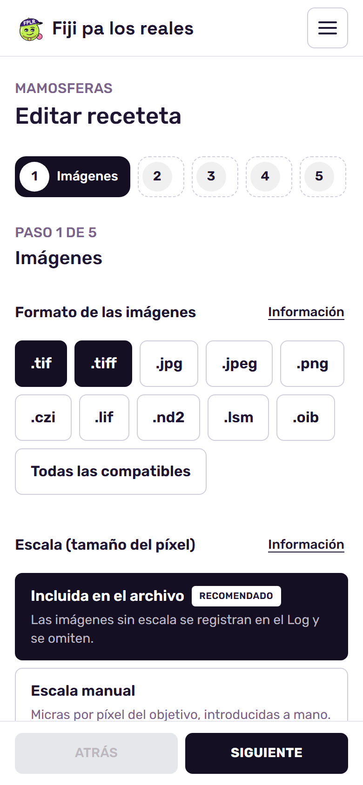
  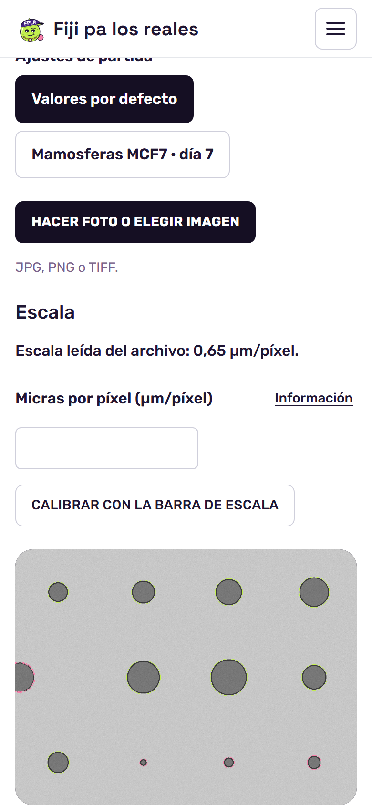
</p>

---

## Plataformas e instalación

| Plataforma | Instalación | Actualizaciones |
| --- | --- | --- |
| **Web** | [fiji-pa-los-reales.vercel.app](https://fiji-pa-los-reales.vercel.app). Puede instalarse como aplicación desde el navegador (Chrome: menú › *Instalar aplicación*; Safari en iPhone: *Compartir* › *Añadir a pantalla de inicio*). | Automáticas. |
| **Android** | Archivo `.apk` de la [última versión](https://github.com/Alejandro-Plata/fiji-pa-los-reales/releases/latest). Android solicita autorización para instalar aplicaciones de esa fuente. | Desde *Ajustes › Actualizaciones*. |
| **Windows 10/11** | Instalador `.exe` de la [última versión](https://github.com/Alejandro-Plata/fiji-pa-los-reales/releases/latest). Al no estar firmado por una entidad certificadora, SmartScreen muestra un aviso la primera vez: *Más información › Ejecutar de todas formas*. | Aviso en la aplicación y descarga del nuevo instalador. |

Para ejecutar los macros se necesita **Fiji** ([descarga gratuita](https://imagej.net/software/fiji/downloads))
en Windows, macOS o Linux. StarDist es opcional y se instala desde el propio Fiji
(*Help › Update › Manage update sites*).

## Buenas prácticas de uso

1. **Validar la receteta** antes de usarla con datos definitivos: analizar 5–10 imágenes
   representativas (incluidas las más difíciles), contarlas también a mano y comparar.
2. **Revisar siempre las imágenes de control.**
3. **No modificar la receteta a mitad de un experimento**: todas las condiciones se analizan con la
   misma.
4. **Archivar el `.ijm` junto a los datos**: su cabecera documenta todos los parámetros.
5. En fluorescencia, **fijar el umbral con controles negativos** adquiridos en las mismas condiciones.
6. En western blot, usar **la imagen original en TIFF** del equipo de adquisición (no JPG ni
   capturas) y evitar la saturación.

---

## Desarrollo

### Tecnologías

- **Vite + React + TypeScript** (estricto), CSS Modules con *tokens* de diseño.
- **Zod** para validar recetetas, enlaces e importaciones.
- **PWA** (`vite-plugin-pwa`): instalable desde el navegador.
- **Capacitor** para Android (con un plugin nativo propio de actualizaciones) y **Electron** para
  Windows.
- **Vitest** (unitarias e instantáneas de macros) y **Playwright** + **axe** (interfaz,
  accesibilidad y responsive de 320 a 1440 px).

### Estructura

```
src/
  dominio/
    recetetas/   esquemas, plantillas, almacenamiento, compartir por enlace
    macros/      generador de macros IJ1 (mamosferas, fluorescencia, western) + instantáneas
    metodos/     texto para Materiales y Métodos (es/en) con referencias
    rapido/      análisis rápido en el navegador (Web Worker)
    umbral.ts    percentiles para el umbral de positividad
  pantallas/     Inicio, Tutorial, Asistente, Resultado, Instrucciones, Rápido, Umbral, Ajustes…
  componentes/   botones, campos, selectores, diálogos, bloque de código…
  textos/es.ts   todos los textos de la interfaz
android/         proyecto Android (Capacitor) + ActualizadorPlugin.java
escritorio/      proceso principal y preload de Electron
scripts/         imágenes sintéticas, validación con Fiji real, iconos, publicación
tests/           pruebas de interfaz (Playwright)
```

### Comandos

```bash
npm install
npm run dev            # servidor de desarrollo
npm test               # pruebas unitarias e instantáneas de macros
npm run e2e            # pruebas de interfaz, accesibilidad y responsive
npm run sinteticas     # genera imágenes de prueba con resultado conocido (Python)
npm run validar:fiji   # ejecuta los macros generados en Fiji real y comprueba los resultados
npm run windows        # empaqueta la aplicación de Windows (release/)
npm run publicar       # publica web, APK e instalador de Windows con su version.json
```

### Validación con Fiji real

Los macros generados se ejecutan en **Fiji 1.54p** sobre imágenes sintéticas con resultado conocido:

- 8 esferas exactas con ambos métodos de detección, también en pilas Z y en JPG de cámara;
- 40 núcleos con un 25 % de células positivas;
- 6 bandas de western con señal creciente y aviso de saturación;
- omisión documentada de imágenes sin escala o con canales inexistentes.

Así se detectaron y corrigieron varias particularidades del lenguaje de macros: `nChannels` no
existe (se usa `getDimensions`), el gestor de ROI debe reiniciarse antes del modo *batch*, los
textos con tildes deben escribirse con `fromCharCode` y una expresión que empieza por número no
concatena cadenas.

Las decisiones de diseño están en [`DISEÑO.md`](DISEÑO.md); la especificación completa, en
[`spec.md`](spec.md).
